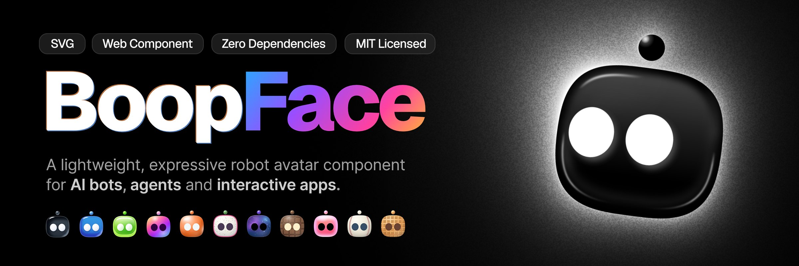
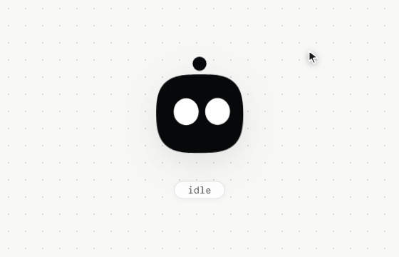
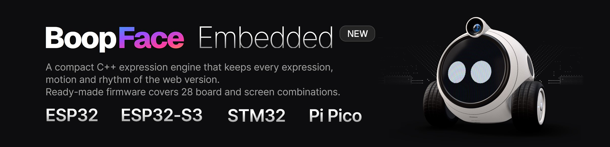
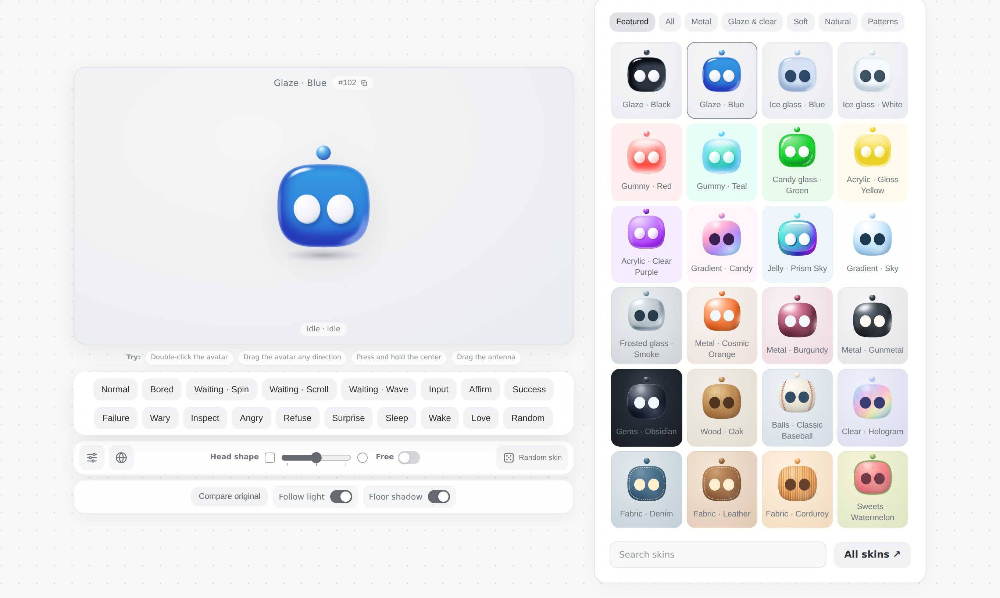
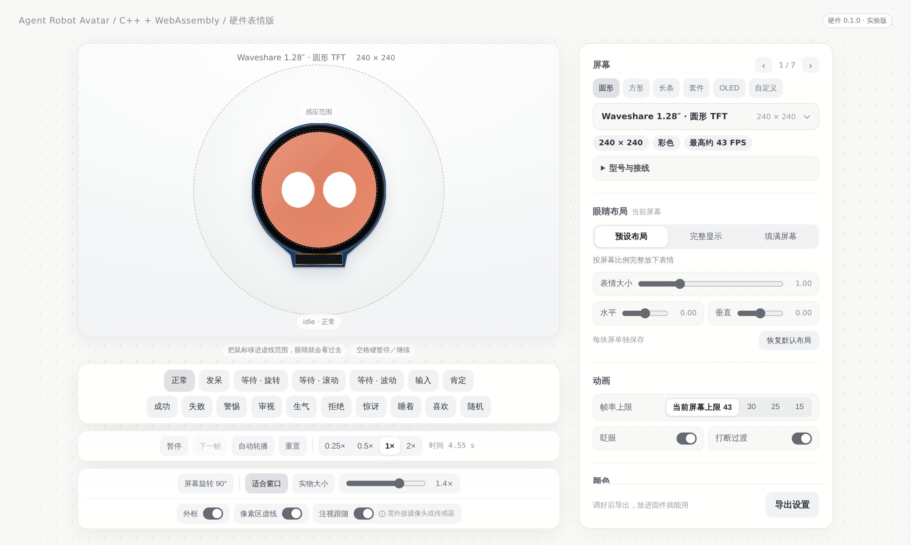

# BoopFace

<p align="center">
  
</p>

[English](https://github.com/CX-ArtLab/boopface/blob/main/README.md) | [简体中文](https://github.com/CX-ArtLab/boopface/blob/main/docs/README.zh-CN.md) | [Español](https://github.com/CX-ArtLab/boopface/blob/main/docs/README.es.md) | [Русский](https://github.com/CX-ArtLab/boopface/blob/main/docs/README.ru.md) | [Français](https://github.com/CX-ArtLab/boopface/blob/main/docs/README.fr.md) | [Português](https://github.com/CX-ArtLab/boopface/blob/main/docs/README.pt.md) | [Deutsch](https://github.com/CX-ArtLab/boopface/blob/main/docs/README.de.md) | [日本語](https://github.com/CX-ArtLab/boopface/blob/main/docs/README.ja.md) | [한국어](https://github.com/CX-ArtLab/boopface/blob/main/docs/README.ko.md) | [繁體中文](https://github.com/CX-ArtLab/boopface/blob/main/docs/README.zh-TW.md)

 [](./LICENSE) [](https://github.com/CX-ArtLab/boopface/actions/workflows/validate.yml) [](https://ko-fi.com/P0E625WIOI)

    

BoopFace is a lightweight, expressive robot avatar component for AI bots, agents and interactive apps. Thinking, waiting, done or failed: every state of an agent can be shown as an expression.

Use it as the face and status feedback of AI assistants and agents: chat assistants like ChatGPT, Claude, Gemini, Grok and DeepSeek, coding agents like Codex, Claude Code, Cursor, Gemini CLI and OpenCode, and always-on agents like Grok Bot, ChatGPT dots, Meta Muse, OpenClaw and Hermes Agent.

It also works for desktop companions, virtual pets, digital mascots, chatbot avatars and other interactive characters, or as a visual feedback layer for AG-UI-style agent interfaces.

Built with SVG and vanilla JavaScript, it is a native Web Component with zero runtime dependencies, MIT licensed. 188 [skins](#skins--new-in-07) are ready to put on at any time.

<p align="center">
  
</p>

<p align="center">
  <a href="#boopface-embedded"></a>
</p>

**[New: BoopFace Embedded](#boopface-embedded)**\
The same eye expressions on ESP32, STM32 and Raspberry Pi Pico screens, or in other C++ programs. Includes firmware examples for 28 board/display configurations and an online simulator with settings export.

## Live Demo

[Open the interactive demo](https://cx-artlab.github.io/boopface/) · [Visit the Skin Gallery](https://cx-artlab.github.io/boopface/skins.html)

[Open the embedded simulator](https://cx-artlab.github.io/boopface/hardware/?lang=en)

## Highlights

- Native Web Component
- SVG rendering + vanilla JavaScript
- Zero runtime dependencies
- Automatic blinking and subtle idle behavior
- Pointer-following eyes and inertial head movement
- Jelly-style drag deformation with elastic recovery
- Press-and-hold squeeze and draggable spring antenna interactions
- Programmatically controlled Agent states and expressions
- Expressions for waiting, success, failure, affirm, wary, inspect, angry, refuse, love and more
- Reduced-motion support
- Configurable sleep behavior
- Adjustable head roundness
- 188 numbered skins in 17 series, with light that follows the pointer
- A lite build without skins for the smallest pages
- TypeScript declarations included

## Install

```bash
npm install boopface
```

```js
import 'boopface';
```

Or download `boopface-x.y.z.zip` from the [latest release](https://github.com/CX-ArtLab/boopface/releases/latest). It holds only the component, skins included. Unzip it next to your page:

```html
<script type="module" src="./boopface/boopface.js"></script>
```

Then add the component:

```html
<boop-face id="avatar"></boop-face>
```

No initialization code is required. The avatar enters its default idle behavior automatically.

### Upgrading from Agent Robot Avatar

BoopFace was called Agent Robot Avatar before version 0.8. Features and usage are unchanged. To upgrade, switch the package name to `boopface`:

```bash
npm uninstall agent-robot-avatar
npm install boopface
```

The old `<agent-robot-avatar>` tag keeps working until 1.0, so there is no rush to change your pages. The old npm package `agent-robot-avatar` gets no more updates; new versions are published only as `boopface`.

### Lite build

For pages that never use skins, `boopface/lite` is the same avatar without any skin code:

```js
import 'boopface/lite';
```

In the lite build the `skin` attribute is ignored, and the console notes that skins need the full build.

Size comparison (transferred over the network, gzip-compressed):

| Build | Size |
| --- | --- |
| Lite `boopface/lite` | about 45 KB |
| Full, page uses no skins | about 56 KB; the skin painting code is not downloaded |
| Full, with skins | about 113 KB; the extra part downloads the first time a skin is used |

## Basic usage

```js
const avatar = document.querySelector('#avatar');

avatar.play('success');
avatar.play('wary');
avatar.play('refuse');

avatar.reset();
```

Available actions:

| Action | Looks like | Use when |
| --- | --- | --- |
| `idle` | Blinks and glances around | Default state |
| `bored` | Glances slowly from side to side | Nothing has happened for a while |
| `waiting-spin` | Eyes circle from side to side | Waiting for a reply (default) |
| `waiting-wrap` | Eyes slide out one side and back in the other | Waiting for a reply |
| `waiting-wave` | Eyes bob up and down in turn | Waiting for a reply |
| `input` | Eyes become blinking text cursors | The user is typing |
| `affirm` | Nods | Got it, confirmed |
| `success` | Happy, smiling eyes | Task completed |
| `failure` | Head and eyes droop | Task or connection failed |
| `wary` | Turns its head and gives a guarded up-and-down look | An action needs confirmation |
| `inspect` | Narrows its eyes and scans up and down | Checking or reviewing something |
| `angry` | Lowered, glaring eyes | Content blocked |
| `refuse` | Shakes its head | Cannot or will not do the request |
| `surprise` | Wide-open eyes | Something unexpected |
| `love` | Eyes merge into a beating heart | Thanks, affection |
| `random` | Eyes spin like slot-machine reels | Random pick, playful moment |
| `sleep` | Closes its eyes and sleeps | No activity for a long time |
| `wake` | Opens its eyes and wakes up | Activity resumes |

Waiting actions play one round with `play()`. `startWaiting({ variant: 'spin' | 'wrap' | 'wave' })` loops until another action starts or `stopWaiting()` is called.

Names from 0.5 (`send`, `warning`, `error`, `blocked`, `slot` and others) still work with a console notice until 1.0; see the [upgrade table](CHANGELOG.md#upgrading-from-05x).

For a real Agent request lifecycle:

```js
avatar.startWaiting();

// Alternative waiting motion: eyes turn out through one side and return through the other.
avatar.startWaiting({ variant: 'wrap' });

// Alternative waiting motion: staggered vertical eye waves.
avatar.startWaiting({ variant: 'wave' });

try {
  const result = await runAgentRequest();
  await avatar.play(result.ok ? 'success' : 'failure');
} catch (error) {
  await avatar.play('failure');
}
```

## Common options

```html
<boop-face
  size="160"
  color="#08090b"
  auto-sleep="30000"
  wake-on="activity"
  motion="auto">
</boop-face>
```

| Attribute | Purpose |
| --- | --- |
| `size` | Avatar size in pixels |
| `color` | Main avatar color |
| `auto-sleep` | Idle time before automatic sleep; `0` disables it |
| `wake-on` | Automatic wake policy: `activity`, `interaction`, or `manual` |
| `motion` | Motion policy: `auto`, `reduce`, or `full` |
| `press-squeeze` | Center press-and-hold squeeze; set to `false` to disable |
| `antenna-drag` | Antenna drag, spring return, and angry reaction; set to `false` to disable |
| `skin` | Skin number, such as `301`; leave it out for the flat color |

Common runtime controls:

```js
avatar.setPointerFollow(false);
avatar.setHeadRoundness(75);
avatar.setPressSqueeze(true);
avatar.setAntennaDrag(true);
```

The avatar center begins the squeeze interaction. Moving more than 4 CSS pixels transfers the same pointer gesture to the existing head drag. Dragging the antenna uses the same pull limit as head dragging and ends with the existing angry reaction.

## Skins · New in 0.7

188 skins in 17 series, with light that follows the pointer. Every skin has a permanent number: the series number followed by two digits, so 305 is the fifth skin of series 3. Titles may be reworded later; numbers never change and are never reused.

Every skin is still pure SVG: no images, canvas or WebGL. All skins together are about 70 KB over the network (about 290 KB uncompressed), and most of it loads only when a page uses a skin. For comparison, the avatar itself (the lite build, without skins) is about 45 KB.



```html
<boop-face skin="301"></boop-face>
```

```js
avatar.setSkin(102);  // or '102'
avatar.setSkin(null); // back to the flat color
```

See every skin with its number on the [all skins page](https://cx-artlab.github.io/boopface/materials/).

| Series | Numbers | Series | Numbers | Series | Numbers |
| --- | --- | --- | --- | --- | --- |
| Glaze | 101–106 | Ice glass | 201–206 | Gummy | 301–312 |
| Candy glass | 401–406 | Acrylic | 501–512 | Jelly | 601–612 |
| Gradient | 701–712 | Frosted glass | 801–806 | Metal | 901–930 |
| Gems and ceramics | 1001–1012 | Wood | 1101–1106 | Balls | 1201–1210 |
| Clear and shimmer | 1301–1305 | Fabric and leather | 1401–1412 | Sweets and fruit | 1501–1512 |
| Nature | 1601–1612 | Patterns and tech | 1701–1717 |  |  |

Skin painters download the first time a skin is used, so a page without skins never loads them. `await loadSkins()` loads them in advance. `SKINS` holds each skin’s Chinese and English titles and colors, `SKIN_SERIES` the series, and `SKIN_NAMES` every number.

Every expression and gesture works with a skin. When the skin is removed, the `color` attribute applies again.

## Events and integration

The component emits `face-state` for visual state changes and `action-state` for semantic action lifecycle changes.

For host integrations and accessibility status text, prefer `action-state`. See [`examples/accessibility.html`](./examples/accessibility.html) for a runnable request-lifecycle example.

A minimal integration example is available at [`examples/basic.html`](./examples/basic.html).

## Compatibility

Designed for modern browsers with support for ES Modules, Custom Elements, SVG, Pointer Events, Web Animations API, `IntersectionObserver`, `ResizeObserver`, and `matchMedia`.

Automated browser tests cover Chromium, Firefox, and WebKit.

<a id="boopface-embedded"></a>

## New: BoopFace Embedded

The Web avatar’s eye expressions now run on robot and development-board displays. The small C++11 engine preserves their motion and timing. Firmware examples cover 28 configurations: ESP32, ESP32-S3, STM32 and Raspberry Pi Pico, with round and rectangular TFT, bar displays, AMOLED and monochrome OLED. Custom screen sizes are supported.

| Your device | Use |
| --- | --- |
| Websites, apps, Android tablets, robots with a browser | Web component: full avatar, skins and interactions |
| ESP32, STM32, Raspberry Pi Pico | Embedded engine with firmware examples |
| Other microcontrollers or C++ programs | Embedded C++ library; supply your own display driver |




**Try it without a board.** The [online simulator](https://cx-artlab.github.io/boopface/hardware/?lang=en) runs the same C++ engine in your browser on 32 simulated screens. It helps you preview a module and compare screen choices.

**Tune, export, build.** Pick a display and adjust layout, colours and frame rate, then choose **Export settings**. Save `eyes_settings.h` next to the example firmware’s `main.cpp` and compile. See the [steps](embedded/README.md). The simulator and exported comments follow your selected language.

**Install from ZIP.** Download `BoopFace-Embedded-0.1.0.zip` from the [embedded release](https://github.com/CX-ArtLab/boopface/releases/tag/eyes-v0.1.0), then use Arduino IDE’s **Sketch → Include Library → Add .ZIP Library**. Arduino Library Manager and PlatformIO registry installation will be added after listing; use the ZIP or source for now.

**In your own program**, play expressions by name:

```cpp
#include <BoopFace.h>
boopface::Eyes eyes;
uint8_t pixels[4800]; // 240 x 160, 1 bit per pixel

void setup() {
  boopface::EyesConfig config;
  eyes.begin(config, pixels, sizeof pixels, millis());
}

void loop() {
  if (eyes.update(millis())) {
    // Send eyes.data() to the display driver.
  }
}

// When needed: eyes.play("success", millis());
```

Experimental: CI compiles every configuration, but none has been verified on physical hardware yet. If you try one, please send a [hardware report](https://github.com/CX-ArtLab/boopface/issues/new?template=hardware_report.yml). See the [embedded guide](embedded/README.md) for the full API and wiring.

## Contributing

Issues and pull requests are welcome. See [`CONTRIBUTING.md`](./CONTRIBUTING.md) before submitting changes.

## Project status

**Current public version: v0.8.0**\
BoopFace Embedded: v0.1.0 (experimental)

The public API is intentionally kept compact while the project evolves toward a future `1.0.0` stability commitment.

BoopFace is independently developed and is not affiliated with, endorsed by, or representative of any AI platform or brand.

## Character design and visual identity

The BoopFace character, including its robot appearance and visual identity, is an original design by CX ArtLab.

The MIT License applies to the software and source code. It allows the avatar to be used, modified, and distributed as part of applications, but it does not transfer ownership of the BoopFace name, character identity, or visual identity, or grant the right to present them as another party's original character or standalone brand.

Third-party product names mentioned in this project describe possible use cases only and do not indicate affiliation or endorsement.

## License

MIT License. See [`LICENSE`](./LICENSE).

---

If this project is useful to you, you can buy me a coffee.

<a href='https://ko-fi.com/P0E625WIOI' target='_blank'></a>

