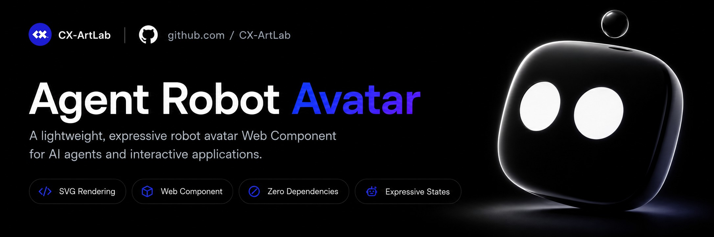
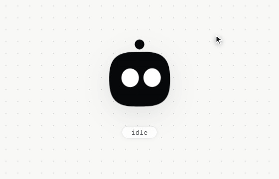
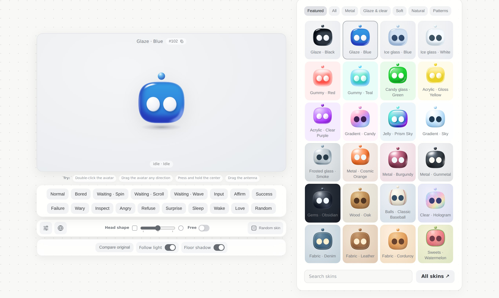

# Agent Robot Avatar

<p align="center">
  
</p>

[English](https://github.com/CX-ArtLab/agent-robot-avatar/blob/main/README.md) | [简体中文](https://github.com/CX-ArtLab/agent-robot-avatar/blob/main/docs/README.zh-CN.md) | [Español](https://github.com/CX-ArtLab/agent-robot-avatar/blob/main/docs/README.es.md) | [Русский](https://github.com/CX-ArtLab/agent-robot-avatar/blob/main/docs/README.ru.md) | [Français](https://github.com/CX-ArtLab/agent-robot-avatar/blob/main/docs/README.fr.md) | [Português](https://github.com/CX-ArtLab/agent-robot-avatar/blob/main/docs/README.pt.md) | [Deutsch](https://github.com/CX-ArtLab/agent-robot-avatar/blob/main/docs/README.de.md) | [日本語](https://github.com/CX-ArtLab/agent-robot-avatar/blob/main/docs/README.ja.md) | [한국어](https://github.com/CX-ArtLab/agent-robot-avatar/blob/main/docs/README.ko.md) | [繁體中文](https://github.com/CX-ArtLab/agent-robot-avatar/blob/main/docs/README.zh-TW.md)

 [](../LICENSE) [](https://github.com/CX-ArtLab/agent-robot-avatar/actions/workflows/validate.yml) [](https://ko-fi.com/P0E625WIOI)

   

Um Web Component leve e expressivo de avatar robô para agentes de IA e aplicações interativas.

Pode ser usado em assistentes de IA, interfaces de agentes, companheiros de desktop, pets virtuais, mascotes digitais, avatares de chatbot e outras experiências com personagens interativos.

É adequado para interfaces de assistentes de IA e agentes, incluindo produtos e experiências semelhantes ao ChatGPT, Claude, Codex, Cursor, Grok Bot, Gemini CLI e OpenCode.

Construído com SVG e JavaScript nativo, funciona como um Custom Element e não possui dependências em tempo de execução.

O Agent Robot Avatar também pode ser usado como camada de feedback visual para interfaces de agentes no estilo AG-UI.

<p align="center">
  
</p>

## Demo ao vivo

[Abrir a demo interativa](https://cx-artlab.github.io/agent-robot-avatar/?lang=pt) · [Visite a galeria de skins](https://cx-artlab.github.io/agent-robot-avatar/skins.html?lang=pt)

## Destaques

- Web Component nativo
- Renderização SVG + JavaScript nativo
- Zero dependências em tempo de execução
- Piscar automático e comportamento idle sutil
- Olhos que seguem o ponteiro e movimento inercial da cabeça
- Deformação local tipo gelatina ao arrastar, com recuperação elástica
- Compressão ao manter pressionado e antena elástica arrastável
- Estados e expressões do Agent controláveis por código
- Expressões para waiting, success, failure, affirm, wary, inspect, angry, refuse, love e mais
- Suporte a movimento reduzido
- Comportamento de sono configurável
- Arredondamento da cabeça ajustável
- 188 skins numerados em 17 séries, com luz que segue o ponteiro
- Versão leve sem skins para as páginas mais enxutas
- Declarações TypeScript incluídas

## Instalação

```bash
npm install agent-robot-avatar
```

```js
import 'agent-robot-avatar';
```

Também é possível carregar diretamente o código-fonte do repositório:

```html
<script type="module" src="./agent-robot-avatar.js"></script>
```

Depois, adicione o componente:

```html
<agent-robot-avatar id="avatar"></agent-robot-avatar>
```

Nenhum código de inicialização é necessário. O avatar entra automaticamente no estado idle padrão.

### Versão leve

Para páginas que nunca usam skins, `agent-robot-avatar/lite` é o mesmo avatar sem o código dos skins:

```js
import 'agent-robot-avatar/lite';
```

A versão leve ignora o atributo `skin` e avisa no console que os skins precisam da versão completa.

## Uso básico

```js
const avatar = document.querySelector('#avatar');

avatar.play('success');
avatar.play('wary');
avatar.play('refuse');

avatar.reset();
```

Ações disponíveis:

| Ação | Aparência | Quando usar |
| --- | --- | --- |
| `idle` | Pisca e olha ao redor | Estado padrão |
| `bored` | Olha devagar para um lado e para o outro | Nada aconteceu por um tempo |
| `waiting-spin` | Os olhos giram de um lado para o outro | Aguardando resposta (padrão) |
| `waiting-wrap` | Os olhos saem por um lado e voltam pelo outro | Aguardando resposta |
| `waiting-wave` | Os olhos sobem e descem alternadamente | Aguardando resposta |
| `input` | Os olhos viram cursores piscantes | O usuário está digitando |
| `affirm` | Acena com a cabeça | Entendido, confirmado |
| `success` | Olhos felizes e sorridentes | Tarefa concluída |
| `failure` | Abaixa a cabeça e os olhos | Falha de tarefa ou conexão |
| `wary` | Vira a cabeça e olha de cima a baixo com desconfiança | A ação precisa de confirmação |
| `inspect` | Aperta os olhos e examina de cima a baixo | Revisar ou verificar algo |
| `angry` | Olhos baixos e fulminantes | Conteúdo bloqueado |
| `refuse` | Balança a cabeça | Não pode ou não vai atender ao pedido |
| `surprise` | Olhos arregalados | Algo inesperado |
| `love` | Os olhos se unem em um coração que bate | Agradecimento, carinho |
| `random` | Os olhos giram como rolos de caça-níqueis | Escolha aleatória, momento divertido |
| `sleep` | Fecha os olhos e dorme | Muito tempo sem atividade |
| `wake` | Abre os olhos e acorda | A atividade volta |

As ações de espera tocam uma rodada com `play()`. `startWaiting({ variant: 'spin' | 'wrap' | 'wave' })` repete até outra ação começar ou `stopWaiting()` ser chamado.

Os nomes da 0.5 (`send`, `warning`, `error`, `blocked`, `slot` e outros) continuam funcionando até a 1.0, com um aviso no console; consulte a [tabela de atualização](../CHANGELOG.md#upgrading-from-05x).

Um fluxo típico de solicitação de Agent:

```js
avatar.startWaiting();

// Segunda espera: os olhos saem por um lado e voltam pelo outro.
avatar.startWaiting({ variant: 'wrap' });

// Terceiro movimento de espera: ondas verticais escalonadas dos olhos.
avatar.startWaiting({ variant: 'wave' });

try {
  const result = await runAgentRequest();
  await avatar.play(result.ok ? 'success' : 'failure');
} catch (error) {
  await avatar.play('failure');
}
```

## Opções comuns

```html
<agent-robot-avatar
  size="160"
  color="#08090b"
  auto-sleep="30000"
  wake-on="activity"
  motion="auto">
</agent-robot-avatar>
```

| Atributo | Uso |
| --- | --- |
| `size` | Tamanho do avatar em pixels |
| `color` | Cor principal do avatar |
| `auto-sleep` | Tempo de inatividade antes do sono automático; `0` desativa |
| `wake-on` | Política de despertar automático: `activity`, `interaction` ou `manual` |
| `motion` | Política de movimento: `auto`, `reduce` ou `full` |
| `press-squeeze` | Pressione o centro para comprimir; `false` desativa |
| `antenna-drag` | Arraste e retorno elástico da antena com reação de raiva; `false` desativa |
| `skin` | Número do skin, por exemplo `301`; omita para a cor lisa |

Controles comuns em tempo de execução:

```js
avatar.setPointerFollow(false);
avatar.setHeadRoundness(75);
avatar.setPressSqueeze(true);
avatar.setAntennaDrag(true);
```

Manter o centro pressionado inicia a compressão. Ao mover mais de 4 pixels CSS, o mesmo gesto passa ao arraste de cabeça existente. A antena usa o mesmo limite de distância e termina com a reação de raiva existente.

## Skins · Novidade na 0.7

188 skins em 17 séries, com uma luz que segue o ponteiro. Cada skin tem um número permanente: o número da série seguido de dois dígitos, então 305 é o quinto skin da série 3. Os nomes podem mudar; os números nunca mudam nem são reutilizados.

Todas as skins continuam sendo SVG puro: sem imagens, canvas nem WebGL.



```html
<agent-robot-avatar skin="301"></agent-robot-avatar>
```

```js
avatar.setSkin(102);  // ou '102'
avatar.setSkin(null); // volta à cor lisa
```

Veja todos os skins com seus números na [página com todos os skins](https://cx-artlab.github.io/agent-robot-avatar/materials/?lang=pt).

| Série | Números |
| --- | --- |
| Esmalte | 101–106 |
| Vidro gelo | 201–206 |
| Goma | 301–312 |
| Vidro bala | 401–406 |
| Acrílico | 501–512 |
| Gelatina | 601–612 |
| Degradê | 701–712 |
| Vidro fosco | 801–806 |
| Metal | 901–930 |
| Gemas e cerâmica | 1001–1012 |
| Madeira | 1101–1106 |
| Bolas | 1201–1210 |
| Transparente e brilho | 1301–1305 |
| Tecido e couro | 1401–1412 |
| Doces e frutas | 1501–1512 |
| Natureza | 1601–1612 |
| Padrões e tecnologia | 1701–1717 |

O código que desenha os skins é baixado na primeira vez que um skin é usado, então uma página sem skins nunca o carrega. `await loadSkins()` o carrega antecipadamente. `SKINS` traz os nomes em chinês e inglês e as cores de cada skin, `SKIN_SERIES` as séries e `SKIN_NAMES` todos os números.

Todas as expressões e gestos funcionam com um skin. Ao remover o skin, o atributo `color` volta a valer.

## Eventos e integração

O componente emite `face-state` para mudanças de estado visual e `action-state` para mudanças semânticas no ciclo de vida das ações.

Para integrações com a aplicação host e textos de status acessíveis, prefira `action-state`. Veja [`examples/accessibility.html`](../examples/accessibility.html) para um exemplo executável do ciclo de vida de uma solicitação.

Um exemplo mínimo de integração está disponível em [`examples/basic.html`](../examples/basic.html).

## Compatibilidade

Projetado para navegadores modernos com suporte a ES Modules, Custom Elements, SVG, Pointer Events, Web Animations API, `IntersectionObserver`, `ResizeObserver` e `matchMedia`.

Os testes automatizados cobrem Chromium, Firefox e WebKit.

## Versão para hardware (em desenvolvimento)

Uma versão em C++ que mostra as expressões do avatar em telas de robôs e placas de desenvolvimento (desenha apenas os olhos) está em desenvolvimento e ainda não foi lançada. Consulte o [guia de hardware](https://github.com/CX-ArtLab/agent-robot-avatar/tree/main/embedded).

## Contribuindo

Issues e Pull Requests são bem-vindos. Consulte [`CONTRIBUTING.md`](../CONTRIBUTING.md) antes de enviar alterações.

## Status do projeto

**Versão pública atual: v0.6.0**

A API pública é mantida deliberadamente compacta enquanto o projeto evolui em direção a um futuro compromisso de estabilidade `1.0.0`.

Agent Robot Avatar é desenvolvido de forma independente e não é afiliado, endossado nem representa qualquer plataforma ou marca de IA.

## Design do personagem e identidade visual

O personagem Agent Robot Avatar, incluindo sua aparência robótica e identidade visual, é um design original da CX ArtLab.

A licença MIT se aplica ao software e ao código-fonte. Ela permite usar, modificar e distribuir o avatar como parte de aplicações, mas não transfere a propriedade do nome Agent Robot Avatar, da identidade do personagem ou de sua identidade visual, nem concede o direito de apresentá-los como personagem original ou marca independente de outra parte.

Os nomes de produtos de terceiros mencionados neste projeto servem apenas para descrever possíveis casos de uso e não indicam afiliação ou endosso.

## Licença

MIT License. Consulte [`LICENSE`](../LICENSE).

---

Se este projeto for útil para você, você pode me pagar um café.

<a href='https://ko-fi.com/P0E625WIOI' target='_blank'></a>
