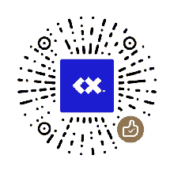

# Agent Robot Avatar

<p align="center">
  
</p>

[English](https://github.com/CX-ArtLab/agent-robot-avatar/blob/main/README.md) | [简体中文](https://github.com/CX-ArtLab/agent-robot-avatar/blob/main/docs/README.zh-CN.md) | [Español](https://github.com/CX-ArtLab/agent-robot-avatar/blob/main/docs/README.es.md) | [Русский](https://github.com/CX-ArtLab/agent-robot-avatar/blob/main/docs/README.ru.md) | [Français](https://github.com/CX-ArtLab/agent-robot-avatar/blob/main/docs/README.fr.md) | [Português](https://github.com/CX-ArtLab/agent-robot-avatar/blob/main/docs/README.pt.md) | [Deutsch](https://github.com/CX-ArtLab/agent-robot-avatar/blob/main/docs/README.de.md) | [日本語](https://github.com/CX-ArtLab/agent-robot-avatar/blob/main/docs/README.ja.md) | [한국어](https://github.com/CX-ArtLab/agent-robot-avatar/blob/main/docs/README.ko.md) | [繁體中文](https://github.com/CX-ArtLab/agent-robot-avatar/blob/main/docs/README.zh-TW.md)

 [](../LICENSE) [](https://github.com/CX-ArtLab/agent-robot-avatar/actions/workflows/validate.yml) [](https://ko-fi.com/P0E625WIOI)

   

一个轻量、富表现力的机器人头像 Web Component，适用于 AI Agent 与交互式应用。

可用于 AI 助手、Agent 界面、桌面伙伴、虚拟宠物、数字吉祥物、聊天机器人头像及其他交互角色体验。

可用于 AI 助手、Agent 界面，包括类似 ChatGPT、Claude、Codex、Cursor、Grok Bot、Gemini CLI 和 OpenCode 的产品与体验。

使用 SVG 与原生 JavaScript 构建，以原生 Custom Element 运行，运行时零依赖。

Agent Robot Avatar 还可作为 AG-UI 风格 Agent 界面的视觉反馈层。

<p align="center">
  
</p>

## 在线 Demo

[打开交互 Demo](https://cx-artlab.github.io/agent-robot-avatar/?lang=zh-CN) · [逛逛皮肤美术馆](https://cx-artlab.github.io/agent-robot-avatar/skins.html?lang=zh-CN)

## 特点

- 原生 Web Component
- SVG 渲染 + 原生 JavaScript
- 运行时零依赖
- 自动眨眼与轻微待机动作
- 眼睛跟随指针与头部惯性运动
- 果冻式局部拖拽形变与弹性恢复
- 按住挤压与可拖动的弹簧天线交互
- 可通过程序控制 Agent 状态与表情
- 支持 waiting、success、failure、affirm、wary、inspect、angry、refuse、love 等表情反馈
- 支持减少动态效果
- 可配置自动睡眠行为
- 可调头部圆角
- 188 款编号皮肤，分 17 个系列，光线跟随鼠标
- 不含皮肤的精简版，适合对大小特别在意的页面
- 内置 TypeScript 类型声明

## 安装

```bash
npm install agent-robot-avatar
```

```js
import 'agent-robot-avatar';
```

也可以直接加载仓库源码：

```html
<script type="module" src="./agent-robot-avatar.js"></script>
```

然后添加组件：

```html
<agent-robot-avatar id="avatar"></agent-robot-avatar>
```

无需初始化代码，头像会自动进入默认待机状态。

### 精简版

如果页面完全用不到皮肤，可以改用 `agent-robot-avatar/lite`，头像和所有表情都一样，只是不含任何皮肤代码：

```js
import 'agent-robot-avatar/lite';
```

精简版会忽略 `skin` 属性，并在控制台提示：皮肤需要使用完整版。

## 基础用法

```js
const avatar = document.querySelector('#avatar');

avatar.play('success');
avatar.play('wary');
avatar.play('refuse');

avatar.reset();
```

可用动作：

| 动作 | 样子 | 适合的场景 |
| --- | --- | --- |
| `idle` | 眨眼、四处看看 | 默认状态 |
| `bored` | 慢慢往两边张望 | 一段时间没有动静 |
| `waiting-spin` | 双眼左右绕圈 | 等待回复（默认） |
| `waiting-wrap` | 双眼从一侧转出、另一侧回来 | 等待回复 |
| `waiting-wave` | 双眼轮流上下起伏 | 等待回复 |
| `input` | 双眼变成闪烁的输入光标 | 用户正在输入 |
| `affirm` | 点头 | 收到、确认 |
| `success` | 开心的笑眼 | 任务完成 |
| `failure` | 低头、眼睛下垂 | 任务或连接失败 |
| `wary` | 侧头、上下打量 | 操作需要用户确认 |
| `inspect` | 眯眼上下扫视 | 检查、审核内容 |
| `angry` | 压低眼睛瞪着 | 内容被拦截 |
| `refuse` | 摇头 | 做不到或不愿做 |
| `surprise` | 睁大眼睛 | 出乎意料 |
| `love` | 双眼合成跳动的爱心 | 感谢、喜欢 |
| `random` | 双眼像老虎机一样滚动 | 随机抽取、逗趣 |
| `sleep` | 闭眼睡觉 | 长时间无操作 |
| `wake` | 睁眼醒来 | 重新有动静 |

等待类动作用 `play()` 播放一轮；用 `startWaiting({ variant: 'spin' | 'wrap' | 'wave' })` 会一直循环，直到播放其他动作或调用 `stopWaiting()`。

0.5 版的旧名字（`send`、`warning`、`error`、`blocked`、`slot` 等）在 1.0 之前仍可使用，但会在控制台提示改名，详见[升级对照表](../CHANGELOG.md#upgrading-from-05x)。

一个典型的 Agent 请求流程：

```js
avatar.startWaiting();

// 第二种等待：眼睛从一侧转出，再从另一侧转入。
avatar.startWaiting({ variant: 'wrap' });

// 另一种等待动作：双眼错开节奏上下波动。
avatar.startWaiting({ variant: 'wave' });

try {
  const result = await runAgentRequest();
  await avatar.play(result.ok ? 'success' : 'failure');
} catch (error) {
  await avatar.play('failure');
}
```

## 常用选项

```html
<agent-robot-avatar
  size="160"
  color="#08090b"
  auto-sleep="30000"
  wake-on="activity"
  motion="auto">
</agent-robot-avatar>
```

| 属性 | 用途 |
| --- | --- |
| `size` | 头像像素尺寸 |
| `color` | 头像主色 |
| `auto-sleep` | 自动睡眠前的空闲时间；`0` 为关闭 |
| `wake-on` | 自动唤醒策略：`activity`、`interaction` 或 `manual` |
| `motion` | 动态效果策略：`auto`、`reduce` 或 `full` |
| `press-squeeze` | 按住头像中心进行挤压；设为 `false` 可关闭 |
| `antenna-drag` | 拖动天线、弹簧复原并接愤怒表情；设为 `false` 可关闭 |
| `skin` | 皮肤编号，例如 `301`；不写则为纯色 |

常用运行时控制：

```js
avatar.setPointerFollow(false);
avatar.setHeadRoundness(75);
avatar.setPressSqueeze(true);
avatar.setAntennaDrag(true);
```

按住头像中心会开始挤压；移动超过 4 个 CSS 像素后，同一次指针操作会切换为原有的头部拖动。拖动天线沿用头部拖动的距离限制，复原后接原有的愤怒反应。

## 皮肤 · 0.7 新功能

共 188 款皮肤，分 17 个系列，光线会跟随鼠标。每款皮肤都有固定编号：前面是系列号，后两位是系列内序号，例如 305 是第 3 个系列的第 5 款。名字以后可能调整，编号永远不变，也不会重复使用。


```html
<agent-robot-avatar skin="301"></agent-robot-avatar>
```

```js
avatar.setSkin(102);  // 也可以写 '102'
avatar.setSkin(null); // 回到纯色
```

所有皮肤及编号见[全部皮肤页](https://cx-artlab.github.io/agent-robot-avatar/materials/?lang=zh-CN)。

| 系列 | 编号 |
| --- | --- |
| 彩色玻璃 | 101–106 |
| 淡彩玻璃 | 201–206 |
| 软糖 | 301–312 |
| 糖果玻璃 | 401–406 |
| 亚克力 | 501–512 |
| 果冻 | 601–612 |
| 渐变 | 701–712 |
| 磨砂玻璃 | 801–806 |
| 磨砂金属 | 901–930 |
| 宝石与陶瓷 | 1001–1012 |
| 木 | 1101–1106 |
| 球类 | 1201–1210 |
| 透明与流光 | 1301–1305 |
| 织物与皮革 | 1401–1412 |
| 甜点与水果 | 1501–1512 |
| 自然 | 1601–1612 |
| 图案与科技 | 1701–1717 |

皮肤的绘制代码在第一次用到皮肤时才下载，不用皮肤的页面完全不加载。`await loadSkins()` 可以提前加载。`SKINS` 提供每款皮肤的中英文名称和颜色，`SKIN_SERIES` 提供系列，`SKIN_NAMES` 提供全部编号。

所有表情和手势都能配合皮肤使用。去掉皮肤后，`color` 属性会重新生效。

## 事件与集成

组件通过 `face-state` 报告视觉状态变化，通过 `action-state` 报告语义动作生命周期变化。

宿主应用集成和无障碍状态播报优先使用 `action-state`。可查看 [`examples/accessibility.html`](../examples/accessibility.html) 中的请求生命周期示例。

最小集成示例位于 [`examples/basic.html`](../examples/basic.html)。

## 兼容性

面向支持 ES Modules、Custom Elements、SVG、Pointer Events、Web Animations API、`IntersectionObserver`、`ResizeObserver` 和 `matchMedia` 的现代浏览器。

自动浏览器测试覆盖 Chromium、Firefox 和 WebKit。

## 硬件表情版（开发中）

在机器人和开发板屏幕上显示表情的 C++ 版本（只画眼睛）正在开发中，尚未发布。详见[硬件接入说明](https://github.com/CX-ArtLab/agent-robot-avatar/blob/main/embedded/README.zh-CN.md)。

## 参与贡献

欢迎提交 Issue 和 Pull Request。提交修改前请阅读 [`CONTRIBUTING.md`](../CONTRIBUTING.md)。

## 项目状态

**当前公开版本：v0.6.0**

公开 API 会在未来 `1.0.0` 稳定性承诺前继续保持精简并谨慎演进。

Agent Robot Avatar 为独立开发的开源项目，不隶属于、代表或获得任何 AI 平台或品牌的官方背书。

## 角色设计与视觉标识

Agent Robot Avatar 角色，包括机器人外观与视觉标识，均为 CX ArtLab 的原创设计。

MIT License 适用于软件和源代码，允许在应用中使用、修改和分发该头像，但不会转移 Agent Robot Avatar 名称、角色身份或视觉标识的所有权，也不授予将其作为其他方原创角色或独立品牌进行展示的权利。

本项目提及的第三方产品名称仅用于说明可能的使用场景，不代表任何关联或官方认可。

## 许可证

MIT License。详见 [`LICENSE`](../LICENSE)。

---

## 请我喝杯咖啡

如果这个项目对你有帮助，也可以请我喝杯咖啡：

| Ko-fi | 支付宝 | 微信支付 |
| --- | --- | --- |
| <a href='https://ko-fi.com/P0E625WIOI' target='_blank'></a> |  |  |

