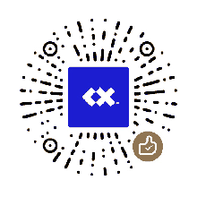

# BoopFace

<p align="center">
  
</p>

[English](https://github.com/CX-ArtLab/boopface/blob/main/README.md) | [簡體中文](https://github.com/CX-ArtLab/boopface/blob/main/docs/README.zh-CN.md) | [Español](https://github.com/CX-ArtLab/boopface/blob/main/docs/README.es.md) | [Русский](https://github.com/CX-ArtLab/boopface/blob/main/docs/README.ru.md) | [Français](https://github.com/CX-ArtLab/boopface/blob/main/docs/README.fr.md) | [Português](https://github.com/CX-ArtLab/boopface/blob/main/docs/README.pt.md) | [Deutsch](https://github.com/CX-ArtLab/boopface/blob/main/docs/README.de.md) | [日本語](https://github.com/CX-ArtLab/boopface/blob/main/docs/README.ja.md) | [한국어](https://github.com/CX-ArtLab/boopface/blob/main/docs/README.ko.md) | [繁體中文](https://github.com/CX-ArtLab/boopface/blob/main/docs/README.zh-TW.md)

 [](../LICENSE) [](https://github.com/CX-ArtLab/boopface/actions/workflows/validate.yml) [](https://ko-fi.com/P0E625WIOI)

    

BoopFace 是一個輕量、富表現力的機器人頭像組件，適用於 AI 機器人、智能體與交互式應用。思考、等待、完成、出錯，智能體的每個狀態都能用一個表情說出來。

適合作爲 AI 助手和智能體的形象與狀態反饋：類似 ChatGPT、Claude、Gemini、Grok、DeepSeek 的對話助手，類似 Codex、Claude Code、Cursor、Gemini CLI、OpenCode 的編程智能體，以及類似 Grok Bot、ChatGPT dots、Meta Muse、OpenClaw、Hermes Agent 的常駐智能體。

也可用於桌面夥伴、虛擬寵物、數字吉祥物、聊天機器人頭像等交互角色，或作爲 AG-UI 風格 Agent 界面的視覺反饋層。

使用 SVG 與原生 JavaScript 構建，是一個原生 Web Component，運行時零依賴，MIT 開源。另有 188 款[皮膚](#皮膚--07-新功能)可以隨時換上。

<p align="center">
  
</p>

## 新支持：[BoopFace Embedded 嵌入式設備版](#boopface-embedded)

<p align="center">
  <a href="#boopface-embedded"></a>
</p>

用於 ESP32、STM32、樹莓派 Pico 等開發板的屏幕，也可以編譯進其他 C++ 程序。\
在桌面小型機器人或各種嵌入式設備上，顯示與網頁版相同的眼睛表情。\
提供固件示例，以及一個支持多種流行開發板和屏幕的在線模擬器，調好後可直接導出設置用於編譯。

## 在線 Demo

[打開交互 Demo](https://cx-artlab.github.io/BoopFace/?lang=zh-TW) · [逛逛皮膚美術館](https://cx-artlab.github.io/BoopFace/skins.html?lang=zh-TW)\
[打開嵌入式設備模擬器](https://cx-artlab.github.io/BoopFace/hardware/?lang=zh-TW)（可預覽 32 種常用嵌入式設備屏幕）

## 特點

- 原生 Web Component
- SVG 渲染 + 原生 JavaScript
- 運行時零依賴
- 自動眨眼與輕微待機動作
- 眼睛跟隨指針與頭部慣性運動
- 果凍式局部拖拽形變與彈性恢復
- 按住擠壓與可拖動的彈簧天線交互
- 可通過程序控制 Agent 狀態與表情
- 支持 waiting、success、failure、affirm、wary、inspect、angry、refuse、love 等表情反饋
- 支持減少動態效果
- 可配置自動睡眠行爲
- 可調頭部圓角
- 188 款編號皮膚，分 17 個系列，光線跟隨鼠標
- 不含皮膚的精簡版，適合對大小特別在意的頁面
- 內置 TypeScript 類型聲明
- BoopFace Embedded 嵌入式設備版：同樣的表情跑在 28 種 ESP32、STM32 和樹莓派 Pico 開發板與屏幕組合上，在線模擬器裏調好後直接導出到固件

## 安裝

```bash
npm install boopface
```

```js
import 'boopface';
```

也可以從[最新發布](https://github.com/CX-ArtLab/boopface/releases/latest)下載 `boopface-x.y.z.zip`，裏面只有組件本身（含皮膚），解壓到網頁旁邊即可：

```html
<script type="module" src="./boopface/boopface.js"></script>
```

然後添加組件：

```html
<boop-face id="avatar"></boop-face>
```

無需初始化代碼，頭像會自動進入默認待機狀態。

### 從 Agent Robot Avatar 升級

BoopFace 原名 Agent Robot Avatar，0.8 版起改名，功能和用法都沒有變。升級只需把包名換成 `boopface`：

```bash
npm uninstall agent-robot-avatar
npm install boopface
```

舊標籤 `<agent-robot-avatar>` 在 1.0 之前仍然可以使用，不用急着改頁面。舊的 npm 包 `agent-robot-avatar` 不再更新，以後的新版本只發布在 `boopface`。

### 精簡版

如果頁面完全用不到皮膚，可以改用 `boopface/lite`，頭像和所有表情都一樣，只是不含任何皮膚代碼：

```js
import 'boopface/lite';
```

精簡版會忽略 `skin` 屬性，並在控制檯提示：皮膚需要使用完整版。

大小對比（網絡傳輸大小，gzip 壓縮後）：

| 版本 | 大小 |
| --- | --- |
| 精簡版 `boopface/lite` | 約 45 KB |
| 完整版，頁面沒用皮膚 | 約 56 KB，皮膚繪製代碼不會下載 |
| 完整版，用到皮膚 | 約 113 KB，多出的部分在第一次用到皮膚時才下載 |

## 基礎用法

```js
const avatar = document.querySelector('#avatar');

avatar.play('success');
avatar.play('wary');
avatar.play('refuse');

avatar.reset();
```

可用動作：

| 動作 | 樣子 | 適合的場景 |
| --- | --- | --- |
| `idle` | 眨眼、四處看看 | 默認狀態 |
| `bored` | 慢慢往兩邊張望 | 一段時間沒有動靜 |
| `waiting-spin` | 雙眼左右繞圈 | 等待回覆（默認） |
| `waiting-wrap` | 雙眼從一側轉出、另一側回來 | 等待回覆 |
| `waiting-wave` | 雙眼輪流上下起伏 | 等待回覆 |
| `input` | 雙眼變成閃爍的輸入光標 | 用戶正在輸入 |
| `affirm` | 點頭 | 收到、確認 |
| `success` | 開心的笑眼 | 任務完成 |
| `failure` | 低頭、眼睛下垂 | 任務或連接失敗 |
| `wary` | 側頭、上下打量 | 操作需要用戶確認 |
| `inspect` | 眯眼上下掃視 | 檢查、審覈內容 |
| `angry` | 壓低眼睛瞪着 | 內容被攔截 |
| `refuse` | 搖頭 | 做不到或不願做 |
| `surprise` | 睜大眼睛 | 出乎意料 |
| `love` | 雙眼合成跳動的愛心 | 感謝、喜歡 |
| `random` | 雙眼像老虎機一樣滾動 | 隨機抽取、逗趣 |
| `sleep` | 閉眼睡覺 | 長時間無操作 |
| `wake` | 睜眼醒來 | 重新有動靜 |

等待類動作用 `play()` 播放一輪；用 `startWaiting({ variant: 'spin' | 'wrap' | 'wave' })` 會一直循環，直到播放其他動作或調用 `stopWaiting()`。

0.5 版的舊名字（`send`、`warning`、`error`、`blocked`、`slot` 等）在 1.0 之前仍可使用，但會在控制檯提示改名，詳見[升級對照表](../CHANGELOG.md#upgrading-from-05x)。

一個典型的 Agent 請求流程：

```js
avatar.startWaiting();

// 第二種等待：眼睛從一側轉出，再從另一側轉入。
avatar.startWaiting({ variant: 'wrap' });

// 另一種等待動作：雙眼錯開節奏上下波動。
avatar.startWaiting({ variant: 'wave' });

try {
  const result = await runAgentRequest();
  await avatar.play(result.ok ? 'success' : 'failure');
} catch (error) {
  await avatar.play('failure');
}
```

## 常用選項

```html
<boop-face
  size="160"
  color="#08090b"
  auto-sleep="30000"
  wake-on="activity"
  motion="auto">
</boop-face>
```

| 屬性 | 用途 |
| --- | --- |
| `size` | 頭像像素尺寸 |
| `color` | 頭像主色 |
| `auto-sleep` | 自動睡眠前的空閒時間；`0` 爲關閉 |
| `wake-on` | 自動喚醒策略：`activity`、`interaction` 或 `manual` |
| `motion` | 動態效果策略：`auto`、`reduce` 或 `full` |
| `press-squeeze` | 按住頭像中心進行擠壓；設爲 `false` 可關閉 |
| `antenna-drag` | 拖動天線、彈簧復原並接憤怒表情；設爲 `false` 可關閉 |
| `skin` | 皮膚編號，例如 `301`；不寫則爲純色 |

常用運行時控制：

```js
avatar.setPointerFollow(false);
avatar.setHeadRoundness(75);
avatar.setPressSqueeze(true);
avatar.setAntennaDrag(true);
```

按住頭像中心會開始擠壓；移動超過 4 個 CSS 像素後，同一次指針操作會切換爲原有的頭部拖動。拖動天線沿用頭部拖動的距離限制，復原後接原有的憤怒反應。

## 皮膚 · 0.7 新功能

共 188 款皮膚，分 17 個系列，光線會跟隨鼠標。每款皮膚都有固定編號：前面是系列號，後兩位是系列內序號，例如 305 是第 3 個系列的第 5 款。名字以後可能調整，編號永遠不變，也不會重複使用。

所有皮膚仍然是純 SVG 繪製，沒有使用圖片、Canvas 或 WebGL。它非常輕：全部皮膚加起來，網絡傳輸只有約 70 KB（不壓縮約 290 KB），而且大部分代碼只在網頁用到皮膚時纔會加載。作爲對比，頭像本身（精簡版，不含皮膚）大約 45 KB。


```html
<boop-face skin="301"></boop-face>
```

```js
avatar.setSkin(102);  // 也可以寫 '102'
avatar.setSkin(null); // 回到純色
```

所有皮膚及編號見[全部皮膚頁](https://cx-artlab.github.io/BoopFace/materials/?lang=zh-TW)。

| 系列 | 編號 | 系列 | 編號 | 系列 | 編號 |
| --- | --- | --- | --- | --- | --- |
| 彩色玻璃 | 101–106 | 淡彩玻璃 | 201–206 | 軟糖 | 301–312 |
| 糖果玻璃 | 401–406 | 亞克力 | 501–512 | 果凍 | 601–612 |
| 漸變 | 701–712 | 磨砂玻璃 | 801–806 | 磨砂金屬 | 901–930 |
| 寶石與陶瓷 | 1001–1012 | 木 | 1101–1106 | 球類 | 1201–1210 |
| 透明與流光 | 1301–1305 | 織物與皮革 | 1401–1412 | 甜點與水果 | 1501–1512 |
| 自然 | 1601–1612 | 圖案與科技 | 1701–1717 |  |  |

皮膚的繪製代碼在第一次用到皮膚時才下載，不用皮膚的頁面完全不加載。`await loadSkins()` 可以提前加載。`SKINS` 提供每款皮膚的中英文名稱和顏色，`SKIN_SERIES` 提供系列，`SKIN_NAMES` 提供全部編號。

所有表情和手勢都能配合皮膚使用。去掉皮膚後，`color` 屬性會重新生效。

## 事件與集成

組件通過 `face-state` 報告視覺狀態變化，通過 `action-state` 報告語義動作生命週期變化。

宿主應用集成和無障礙狀態播報優先使用 `action-state`。可查看 [`examples/accessibility.html`](../examples/accessibility.html) 中的請求生命週期示例。

最小集成示例位於 [`examples/basic.html`](../examples/basic.html)。

## 兼容性

面向支持 ES Modules、Custom Elements、SVG、Pointer Events、Web Animations API、`IntersectionObserver`、`ResizeObserver` 和 `matchMedia` 的現代瀏覽器。

自動瀏覽器測試覆蓋 Chromium、Firefox 和 WebKit。

<a id="boopface-embedded"></a>

## 新支持：BoopFace Embedded 嵌入式設備版

與網頁版相同的表情，現在也可以用在機器人和開發板的屏幕上。一個小巧的 C++ 庫移植了網頁版的全部表情，動作和節奏都與網頁版一致。固件示例支持 28 種開發板和屏幕組合，覆蓋 ESP32、ESP32-S3、STM32 和樹莓派 Pico：圓形和方形 TFT、長條屏、AMOLED 和單色 OLED，也可以自定義屏幕尺寸。

| 你的設備 | 用哪個 |
| --- | --- |
| 網頁、App、安卓平板、帶瀏覽器的機器人 | 網頁版（本組件）：完整頭像、皮膚和互動 |
| ESP32、STM32、樹莓派 Pico 等開發板 | 嵌入式設備版，有固件示例 |
| 其他單片機或 C++ 程序 | 嵌入式設備版的 C++ 庫，自己接屏幕驅動 |


**沒有板子也能先預覽效果。** [在線模擬器](https://cx-artlab.github.io/BoopFace/hardware/?lang=zh-TW)在瀏覽器裏就能運行同一套 C++ 引擎，模擬 32 種屏幕，你可以大致看到它在真實模組上的樣子，選購屏幕時也能拿來參考。

**調好，就能直接用。** 選好你的屏幕，調整佈局、顏色和幀率，點「導出設置」。把導出的 `eyes_settings.h` 放進示例固件再編譯，板子上顯示的就是模擬器裏的樣子。詳見[操作步驟](../embedded/README.zh-CN.md#在模擬器裏調好直接用到板子上)。

**安裝。** 從[嵌入式發佈頁](https://github.com/CX-ArtLab/boopface/releases/tag/eyes-v0.1.0)下載 `BoopFace-Embedded-0.1.0.zip`，在 Arduino IDE 裏選「項目 → 導入庫 → 添加 .ZIP 庫」安裝。Arduino 庫管理器索引仍在更新，目前請使用 ZIP 或原始碼。[PlatformIO](https://registry.platformio.org/libraries/cxlab/BoopFace) 使用者可在 `platformio.ini` 的環境設定中加入：

```ini
lib_deps = cxlab/BoopFace@^0.1.0
```

**在你自己的程序裏**，按名字播放表情：

```cpp
#include <BoopFace.h>
boopface::Eyes eyes;
uint8_t pixels[4800]; // 240 x 160，每個像素 1 位

void setup() {
  boopface::EyesConfig config;
  eyes.begin(config, pixels, sizeof pixels, millis());
}

void loop() {
  if (eyes.update(millis())) {
    // 把 eyes.data() 發送到屏幕。
  }
}

// 需要時：eyes.play("success", millis());
```

實驗版：所有配置都在 CI 中編譯通過，但還沒有在真實硬件上驗證。如果你在實物上運行過，歡迎提交[實機驗證報告](https://github.com/CX-ArtLab/boopface/issues/new?template=hardware_report.yml)。完整說明見[嵌入式設備版說明](../embedded/README.zh-CN.md)。

## 參與貢獻

歡迎提交 Issue 和 Pull Request。提交修改前請閱讀 [`CONTRIBUTING.md`](../CONTRIBUTING.md)。

## 項目狀態

**當前公開版本：v0.8.0**（網頁版）\
BoopFace Embedded 嵌入式設備版：v0.1.0（實驗版）

公開 API 會在未來 `1.0.0` 穩定性承諾前繼續保持精簡併謹慎演進。

BoopFace 爲獨立開發的開源項目，不隸屬於、代表或獲得任何 AI 平臺或品牌的官方背書。

## 角色設計與視覺標識

BoopFace 角色，包括機器人外觀與視覺標識，均爲 CX ArtLab 的原創設計。

MIT License 適用於軟件和源代碼，允許在應用中使用、修改和分發該頭像，但不會轉移 BoopFace 名稱、角色身份或視覺標識的所有權，也不授予將其作爲其他方原創角色或獨立品牌進行展示的權利。

本項目提及的第三方產品名稱僅用於說明可能的使用場景，不代表任何關聯或官方認可。

## 許可證

MIT License。詳見 [`LICENSE`](../LICENSE)。

---

## 請我喝杯咖啡

如果這個項目對你有幫助，也可以請我喝杯咖啡：

| Ko-fi | 支付寶 | 微信支付 |
| --- | --- | --- |
| <a href='https://ko-fi.com/P0E625WIOI' target='_blank'></a> |  |  |
